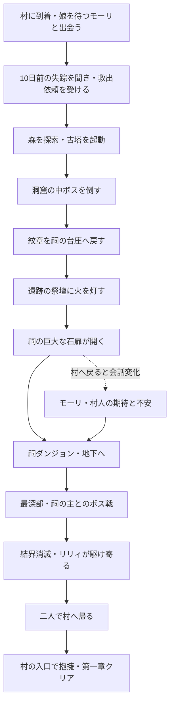

# まんまるぶうの冒険 ― 封印の祠

第一章・ゲーム詳細設計 v1.3 / 2026-09-27

この文書を今回の改修の実装基準とする。現在の種集め、旧マップ、旧章の結末を置き換え、最初から最後まで「長老モーリの娘リリィを助け、村へ連れ帰る」冒険にする。第一章の実装と2026-09-27の試遊フィードバックを反映。今回の実装差分は WORLD_OVERHAUL_20260927.md に記す。

技術構成・素材加工・実装順・検証の詳細は [実装仕様書](C:/Users/rukat/manmarubuu-travel/docs/SEALED_SHRINE_IMPLEMENTATION.md)、今回確認した素材一覧は [素材調査データ](C:/Users/rukat/manmarubuu-travel/docs/asset-audit.json) に記す。

## 1. 作品の柱と完成範囲

| 項目 | 決定内容 |
| --- | --- |
| ジャンル | まんまるぶう一人を操作する、三人称探索＋コマンド戦闘の3DファンタジーRPG |
| 主目的 | リリィを救出してモーリのもとへ連れ帰る |
| 第一章の長さ | 初見2.5～4時間を目安とする。ボス到達Lv.25前後、レベル上限なし。相棒の試遊で調整する |
| 探索 | 手作業で構成した村・森・古塔・洞窟・遺跡・祠。シンボルエンカウント |
| 戦闘 | コマンドを選ぶと、まんまるぶうと敵が移動し、技専用のカメラと演出で攻防を見せる |
| 世界の見た目 | 温かい石と漆喰、木組み、厚みのある屋根、豊かな植生、奥行きのある光。王道RPGの親しみと冒険感 |
| キャラクター | まんまるぶうの原作Blenderモデルの丸み・閉じた刺繍の目・布・短い毛並みを尊重。村人はモーション付きの人型ファンタジーアセットへ置換 |
| 対象環境 | WindowsのWebGL2対応Chrome/Edge。RTX 4060搭載デスクトップから一般的なノートPCまで品質設定で対応 |
| 完成条件 | 過去の失踪の聞き取りから三段階の封印解除、祠攻略、ボス、救出、二人で帰還、抱擁、第一章クリアまで実際に遊べる |

まんまるぶう一人に対し、敵は一体～最大三体の少数グループ戦にする。街づくり、仲間編成、素材クラフト、収集率、日替わり依頼、第二章、広大なオープンワールドは追加しない。宝箱や買い物は救出を助ける寄り道として置く。

最高品質は、素材数やエフェクト数を増やすことだけで判断しない。街の構図、歩く導線、まんまるぶうの顔の見え方、攻撃の重さ、救出と再会の芝居に制作量を集中する。品質設定を下げても、物語・敵の行動・戦闘カメラ・主要建築・顔の判読性は共通にする。

## 2. 導入と封印の設定

旅の途中、まんまるぶうはこもれび村に立ち寄る。リリィは10日前に魔物に連れ去られたまま、帰ってきていない。村は娘を待つモーリと、帰還を願う村人たちの生活から始まる。救出までリリィを村には配置しない。

広場のモーリが、10日前の出来事と、追いかけた村人が祠の封印に阻まれたことを話す。誘拐の実演、影の魔物の襲来、追跡イベントは削除する。まんまるぶうは事情を聞き、封印の解除方法を教わって救出の旅へ出る。

モーリの依頼は指定の台詞を採用する。

> 頼む……娘を助けてくれ。  
> あの祠の封印を解く方法なら、村に伝わっておる。

設定上の整合性を次のように固定する。

- 祠には昔、村人たちが封じた魔物の主がいる。古くなった封印の亀裂から、主の影の眷属だけが漏れ出した。
- 影の眷属は捕えたリリィを魔力で包んで亀裂を通った。村人が普通に歩いて通れる入口は開いていない。
- 三つの仕掛けは、村の封印守が祠へ入るための古い手順である。外側の結界と石扉を順に解くが、主を閉じ込める最深部の封印までは自動解除しない。
- 主は内側から封印を壊す力を取り戻そうとしている。事情は祠の壁画で分かるが、冒険の目的表示は最後までリリィの救出のままにする。
- 解除手順は最初からモーリが教える。物語を進めるために同じ説明を何度も聞きに戻らせない。

導入はプレイヤーが送れる会話のみ。依頼受諾後に回復し、北門・古塔への案内を出す。旧セーブのabductionSeenは、事情を聞いた状態abductionKnownへ移行し、既存の冒険進行を保持する。

## 3. 章全体の進行



| 段階 | 遊ぶ内容 | 完了時の世界の変化 | 次の案内 |
| --- | --- | --- | --- |
| 依頼 | 村の広場で10日前の出来事と封印の手順を聞く | 森の進路が示される。道具屋で初回支援を受け取れる | 森の古塔を動かす |
| 古塔 | 森の戦闘、塔の登坂、回転盤 | 塔の光が祠へ届き、外側の結界が一枚消える | 洞窟で紋章を取り戻す |
| 洞窟 | 分岐と近道、中ボス戦 | 封印の紋章を確実に獲得 | 祠前の台座に紋章を戻す |
| 紋章返還 | 台座を調べる | 第二の結界が解け、遺跡の水門装置に光が入る | 遺跡の祭壇に火を灯す |
| 遺跡 | 水門と石橋、祭壇点火 | 祠の石扉が開く。村人の会話・立ち位置が変わる | 祠へ入り、リリィを探す |
| 祠 | 三段階の地下空間、壁画、強敵 | 最深部への道がつながる | リリィを守る結界の主を倒す |
| 主の撃破 | 二段階のボス戦 | リリィの結界が消える | リリィのもとへ行く |
| 救出 | 駆け寄りと会話 | リリィが同行する。帰路の敵が退く | リリィと村へ帰る |
| 凱旋 | 二人で帰路を進み、村の入口へ | モーリとの抱擁。第一章クリア | 救出後の村を歩ける |

塔→洞窟→紋章返還→遺跡の順で進める。後の場所へ先に歩いて行くことはできるが、仕掛けの状態と現地の説明から必要な手順が分かるようにする。主目的のHUDは常に「リリィを助ける」、その下に現在の一手だけを表示する。

## 4. ワールド構成と移動

地理は新規設計する。旧マップの座標、建物配置、一本道の森、旧番人の配置は引き継がない。物語の目印を見渡せる一つの地方として構成し、内部的にはエリアを分けて読み込む。

```text
                         北
                  封印の祠・前庭
                    │ 地下へ
                 祠ダンジョン
                      │
         西：古塔 ─ 森の分岐広場 ─ 東：洞窟
                      │     ＼
                      │       北西：灯守りの遺跡
                こもれび村・北門
              モーリ家／広場／市場
                小川と石橋・南入口
                         南
```

これは接続関係の図であり、各ダンジョンの内部を同じ平面へ押し込まない。古塔・祠・遺跡の輪郭を森の複数地点から見せ、道標、川、地形、灯りでも方向が分かるようにする。

| エリア | 規模の目安 | 構成と見せ場 |
| --- | --- | --- |
| こもれび村 | 約140×120m | 南の石橋、市場のある広場、高台のモーリ家、大樹、北門。12棟を目安に高低差のある街並み |
| こもれびの森 | 約260×220m | 木漏れ日、小川、曲がった道、分岐広場、古塔を望む丘、祠へ向かう冷たい林 |
| 風見の古塔 | 外周約45×45m＋三層 | 崩れた外階段、塔内の踊り場、開けた屋上。階段は歩行で登れる |
| 苔岩の洞窟 | 約110×80m相当・三室 | 入り口の光、光る鉱脈、分岐、近道扉、広い中ボスの巣 |
| 灯火の遺跡 | 約160×120m | 柱列、水路、二つの水門、上がる石橋、遠景の祠を望む祭壇 |
| 祠の前庭 | 約100×90m | 巨大な石扉、三層の封印表現、紋章台座、休息地点 |
| 祠内部 | 三つの小エリア | 灯の回廊、封印の記憶、主の間。合計6～8室程度で濃い探索を作る |

面積と距離は初期配置用の目安。空地を増やして広さを稼がない。通常の移動速度は歩き4.2m/s、走り6.5m/sから開始し、スタミナ消費は設けない。分岐広場から各目的地までは、寄り道なしの走行で30～60秒程度を狙う。

森には一方向の近道を二か所作り、攻略後に開く。祠前の休息地点は無料回復と記録に使える。初訪問後は村と祠前を移動できる案内地点も開き、紋章返還や買い物の往復を短くする。

### 村を「生活のある場所」にする配置

- 南入口から橋を渡ると、曲がった道の先に大樹と広場が見える。初見で村の中心が分かる構図にする。
- 広場に井戸、露店、荷車、パンの店先、ベンチ。裏道には薪、物干し、畑、植木鉢を目的を持って配置する。
- モーリの家は広場を見下ろす小さな高台に置く。家の前から祠の方角を見られる。
- 建物は高さ、屋根方向、間口、増築、外階段、バルコニーを組み合わせる。同じ家を等間隔で並べない。
- 入れる建物はモーリ家、宿、道具屋、装備屋兼鍛冶場、礼拝堂、パン屋の6棟。室内にも対応する用途と人物を置く。
- 広場の主動線は約4～6m、裏道は約2.5～3mを目安にする。装飾で歩行路や会話位置を塞がない。
- 昼夜の自動サイクルは持たせず、事件前、救出中、凱旋後の三つの照明・音・NPC配置で印象を変える。

## 5. 三つの封印解除

### 5.1 風見の古塔：視界が開ける探索と仕掛け

森の初戦で「体当たり」「ぼうぎょ」「回復」を覚える。塔は外階段→内部→屋上の順に登り、途中の窓から村と祠を見せる。落下してやり直すジャンプアクションは必須にしない。

屋上には三つの回転盤。「左：朝＝芽／中央：昼＝太陽／右：夜＝月」の対応を操作パネルへ明示する。各盤は「月→芽→太陽」の順に回し、現在値と正解した盤が同時に分かる。全て正しければ同じ画面の起動ボタンを押せる。内部の解は [1, 2, 0]。

誤操作で敵が増えたり進行を失ったりしない。手帳からヒントを段階表示できる。正解後は塔の中心に光が上がり、祠を覆う外側の結界がほどける短い遠景カットを挟む。盤の状態と起動済み状態を保存する。

### 5.2 苔岩の洞窟：紋章奪還と中ボス

入口から二つの短い分岐があり、一方は回復道具と紋章に関する痕跡、もう一方は奥へつながる。最奥へ着く前に内側から近道の扉を開けられる。暗闇だけで道を迷わせず、鉱脈と足跡で方向を示す。

中ボスは仮名「岩鎧のガルム」。大きな岩の腕と胸の紋章が特徴。防御姿勢→力をためる→重い叩きつけ→隙ができる、という読みやすい攻防を持つ。ぼうぎょで大技を受け、隙に攻撃系特技や、チャージ済みならツノドリルを当てると有利になる。

勝利時に紋章を確実に獲得する。ランダムドロップにせず、取り忘れて詰まる配置にも置かない。紋章は売却・消費できない大事な物として扱い、祠前の専用台座に戻すと第二の結界が消える。

### 5.3 灯火の遺跡：地形が変化し、石扉が開く

遺跡は水路で区切られている。最初の水門を「排水」にすると下段の通路が現れ、奥の二つ目を「通水」にすると上段の石橋が上がる。水位は決まった二段階を補間し、流体シミュレーションは用いない。

橋の先の古い祭壇には火種が残っている。紋章返還によって装置が動き、祭壇を調べると火が灯る。火の線が石の溝を走り、塔・台座・祭壇の印が呼応する。祠の巨大な石扉が重い音とともに開くカットへつなぐ。

この瞬間を前半最大の見せ場にする。短い振動、舞う塵、石扉の重量感、森へ広がる光、音楽の切り替えを揃える。イベント後も遺跡の出口へ戻れて、祠前への近道が使える。

## 6. 祠ダンジョンと壁画

| 深さ | 空間 | 遊びと物語 |
| --- | --- | --- |
| 第一層「灯の回廊」 | 外光が差す石の回廊。苔と古い灯火 | 村人が封印を作った壁画。最初の影の番兵。脇道の回復箱 |
| 第二層「封印の記憶」 | 青い封印光、長い影、低い残響 | 村を襲う主の壁画と、封印守の進入路の説明。石兵。横道から戻れる近道 |
| 最深部「主の間」 | 高い天井、壊れた封印柱、中央の広い床 | 奥のリリィ、守る魔法の結界、祠の主との対面と戦闘 |

壁画は三枚。近づけば構図で内容を想像でき、調べると一～三行の説明を読む。必要な道順を長文の読解だけに依存させない。

地下ほど環境の明るさと色を落とす一方、まんまるぶうの輪郭、足元、階段の端、出口は判別できる。重要な扉の前に操作できない瓦礫を山積みにしない。全ての品質で灯火と進路の手掛かりを残す。

最深部手前に無料の回復・記録地点を置く。ボス前には準備画面を開ける。リリィを視認したあと、主がまんまるぶうとの間へ降り立つ。

> 封印を破り、ここまで来たか……

## 7. 戦闘・育成・装備

この章の詳しい解放表、敵ごとの行動、装備、チャージと保存の契約は [戦闘・育成・装備の詳細仕様](C:/Users/rukat/manmarubuu-travel/docs/COMBAT_PROGRESSION_SPEC.md) にまとめる。通常特技はSP配分で習得し、ツノドリルは独立したひっさつとして扱う。最終ボスの推奨到達レベルは25前後とする。

| 項目 | 決定内容 |
| --- | --- |
| レベル | 最終ボスLv.25前後、上限なし。Lv.25自体は扉の条件にしない |
| レベル進行 | 森1～5→古塔6～9→洞窟10～14→遺跡15～19→祠20～25 |
| ポイント | 5レベル帯ごとに4→5→6→7→8→9→10SP。Lv.31以降は10SP |
| 育成系統 | たいじゅつ／まもり／ひだまり／かぜ。各100SPまで |
| 解放 | 系統累計4/10/18/28/40/55/75/100SP。通常特技16＋常時効果16 |
| 振り直し | 村の礼拝堂で無料。系統特化と複数系統の組み合わせを試せる |
| 必殺技 | ツノドリルを独立した「ひっさつ」にする。SP不要・MP消費0 |
| チャージ | 攻防で0～100まで蓄積。100で三回の行動選択機会まで発動可能。戦闘終了で解除 |
| 装備 | ツノ飾り／頭／からだ／足／おまもりの5部位、合計36点を制作目標 |
| 外見 | 装備に合わせて形状・色・小物が変わる。所持装備から見た目だけの指定も可能 |
| 敵 | 通常12種、強敵4種、物語ボス2体。敵は最大三体 |
| 救出後 | 既存エリアで任意の残響の試練を三つ。Lv.26～30と最終装備を使う |

通常コマンドは「たたかう／とくぎ／ぼうぎょ／どうぐ／ひっさつ／にげる」。たたかう・ぼうぎょ・どうぐ・にげるにSPは不要。通常戦の逃走は成功し、物語ボスでは使えない。危険な攻撃は先に予告し、プレイヤーに判断の機会を与える。

特技の例はころころ突進、みだれころがり、かちわり体当たり、まんまる流星、ぽよんバリア、まんまる返し、ひだまりの息、光のつぶて、砂けむり、追い風、つむじかぜ。レベルだけで一斉に覚えず、配分で得られる技を変える。育成画面に次の特技と不足SPを表示する。

敵には回復、仲間をかばう、毒、幻惑、眠り、MP封じ、属性、ため、隙、二連撃、召喚を用意する。行動はHPや仲間の状態、前の行動、クールダウンから選ぶ。回復役を先に倒す、防御の敵へ属性技を使う、相手の予告に合わせて守るなど、選択の意味を変える。

まんまるぶう一人が操作不能にされ続けないよう、眠りは最大一行動休みで、解除直後の連続付与を防ぐ。回復系統を選ばなくても道具と装備で対処できる。複数の敵に対する防御は、そのターンの敵の行動群が終わるまで持続する。

通常戦30～75秒、中ボス3～5分、章ボス5～8分を初期目標とする。主経路の戦闘と節目の経験値でLv.24～26に届くよう収支を設計する。同じ敵の周回を必須にしない。

宿と買い物を残し、無料回復を村の礼拝堂・祠前・ボス前へ置く。全滅時は直近の安全地点へ戻り全回復、所持金を10%減らす。経験値、SP、装備、紋章、封印解除を失わない。

ガルムは殻の防御と大技後の隙を持ち、HP50%以下で攻め方を変える。主ヴェルガはHP50%で一度だけ段階移行し、最大二体の眷属と最大二行動を使う。各ビルドと道具で勝てるように調整し、必殺の発動だけを勝利条件にしない。撃破後はすぐ救出へ進む。

## 8. 戦闘演出の詳細

全ての攻撃を「予備動作→接近／発射→命中→反応→次の構え」の五段階で作る。まんまるぶうと敵を固定位置へ毎回往復させない。行動後は前後左右の安全な位置へ移り、次の攻撃をその位置から始める。

三体戦では敵全員を把握できる構図から選択対象へ寄り、全体技では対象全体を画に収める。習得した通常特技16種には系統別の演出を用意し、ツノドリルを最も強い専用演出にする。

舞台は森・洞窟・遺跡・祠の4テーマに分け、遭遇場所と同じ素材と照明を使う。主の間はボス専用の背景を持つ。戦闘開始時に敵味方の位置関係が分かる短い引きの画を入れ、操作中は両者を見渡せる画へ戻す。

| 演出 | 時間の目安 | 動きとカメラ | 命中時の見せ方 |
| --- | --- | --- | --- |
| 体当たり | 1.8～2.4秒 | 低い前斜めで踏み込み→横から追走→敵側の斜めへ切り替え | 胴の沈み、短い停止、敵の後退、足元の土煙 |
| ツノドリル（ひっさつ） | 4.5～5.5秒 | 顔と角の寄り→曲線で加速→低い斜め横から突き抜けを捉える | 回転の残像、角の火花、敵のねじれと滑り |
| まんまる流星 | 4.0～4.8秒 | 見上げる上昇→俯瞰で落下地点を見せる→地面すれすれの着地 | 接地に衝撃波、破片、低音、敵の浮きと着地 |
| ぼうぎょ／バリア | 0.8～1.2秒 | まんまるぶうの正面斜め。体を沈めて踏ん張る | 衝撃を受けて圧縮→弾性のある戻り。バリアだけ光の膜 |
| 回復 | 1.0～1.4秒 | 顔の見える中寄り。柔らかい小さな回り込み | 息、胸元の光、HP表示と回復音 |
| 通常敵の攻撃 | 1.5～2.2秒 | 敵の予備動作→踏み込みを追う→まんまるぶうの反応 | まんまるぶうのHit、耳と体の遅れ、足の踏み直し |
| ボスの大技 | 3.0～4.5秒 | 大きさが伝わる低い画→進路の引き→命中を横から | 床・柱・塵も反応。最後は次の判断ができる引きへ |

体当たりの基準タイムラインは、0.00秒で沈み、0.18秒で加速、0.65秒で接近、0.95秒で命中、1.08秒から敵の後退、1.45～2.10秒で双方が新しい構えへ移るものとする。ここを元に音とカメラを同期させる。

命中の停止は通常50～70ms、大技80～100msを初期値とする。モデルと演出時間だけを短く止め、UIの操作やブラウザ処理そのものを止めない。ダメージ、ヒット音、エフェクト、HP表示は同一の命中イベントから発火する。

カメラは普段FOV50～55度、寄り40～48度、速度感を出す区間58～64度を目安にする。通常攻撃のカットは2～3、必殺技は最大4。顔を隠す真後ろだけの画や、壁の中に入る画を避け、位置関係を保つ。躍動感は移動と構図から作り、常時の激しい揺れには頼らない。

設定に「カメラ演出：標準／控えめ」「画面揺れ：0～100%」「戦闘速度：通常／速い」を設ける。「速い」は約1.5倍を基準とし、長い間と帰りの移動を短縮する。どの設定でもダメージや行動順は変わらない。

## 9. まんまるぶうの見た目とモーション

元モデルの特徴は、温かい生成り色の短いループ状の毛、ピンクの鼻と手足、縫い目、ココア色の閉じた刺繍の目である。別の目のデザインへ置き換えて解決しない。

ゲーム用モデルは以下の層で構成する。

1. 丸い輪郭と顔の形を保つ本体メッシュ。
2. 元の布・毛束・縫い目から焼き付けた色、法線、粗さ、陰影のテクスチャ。
3. 独立して保護した刺繍の目・鼻・主要な縫い目。
4. 高品質時の布の柔らかい反射と、輪郭にだけ配置する短い毛カード・少量のループ形状。

Blenderの全ての毛を三角形にして持ち込まず、近くで見える部分に形状を配分する。逆に本体と刺繍を一律に同じ比率へ減らす処理もやめる。閉じた目の形、表面からの出方、色の差は専用に扱う。

現行13クリップは維持する。Idle、Walk、Run、Battle_Idle、BodyBlow、HornDrill、Guard、Hit、KO、Victory、Jump_Start、Jump_Air、Landingを、移動・技・リアクションに対応させる。移動ルートと既存モーションの速度を合わせて足滑りを抑える。足りない芝居だけ、このプロジェクト内の派生モデルへ追加する。

顔の近くへ寄る会話と攻撃カットでは高い詳細度を選ぶ。軽量設定でも刺繍の目と鼻、輪郭は残し、遠い草や影から負荷を落とす。見た目の最終判定は相棒の実画面レビューで行う。

## 10. 人型の村人と会話

ウサギNPCは廃止。KayKitの人型モデルを使い、服、身長、髪、姿勢、仕事のモーションで区別する。主要NPC8人＋生活演出用4人を初期上限とする。

| 人物 | 外見・役割 | 主な場所 |
| --- | --- | --- |
| 長老モーリ | 年配の人型、白い髭、深緑の服。依頼と再会の中心 | モーリ家／事件中の祠前／凱旋時の北門 |
| リリィ | 小柄な人型、柔らかな色の服 | 導入の広場／祠最深部／帰路／救出後の家 |
| 宿屋の主人 | 丸い体、エプロン | 宿 |
| 道具屋 | 鞄と薬瓶 | 道具屋・露店 |
| 鍛冶屋 | 袖まくり、革の前掛け | 鍛冶場 |
| 礼拝堂の世話役 | 落ち着いた色の衣服 | 礼拝堂 |
| 門番 | 槍ではなく灯りと警笛を主な小物にする | 北門 |
| リリィの友達 | 小柄、明るい服 | 広場・凱旋時の北門 |

主要NPCには事件前／依頼後／塔起動後／紋章返還後／祠開放後／救出後の会話を用意する。一人につき毎回長文を増やさず、変化が分かる一～三行を基本とする。

祠開放後は指定された会話を採用する。

> 本当に祠が開いたぞ……  
> リリィ、まだ無事かな……  
> まんまるぶう、お願い。連れて帰ってきて。

この変化を見るためだけに村へ帰ることを強制しない。戻った人に応える内容にする。

## 11. 救出、同行、凱旋

ボス撃破後、リリィの魔法の結界が消える。まんまるぶうが近づくとリリィが顔を上げ、まんまるぶうのところへ2～4mほど実際に走ってくる。

> 助けに来てくれたの……？  
> ありがとう、まんまるぶう！

会話後、リリィがまんまるぶうの少し後ろを歩く。道の角や階段でも追従でき、エリアを移っても同行を維持する。戦闘能力や護衛HPは持たせない。助けた直後に失敗する護衛クエストにはしない。

祠には出口へ続く近道が開く。地上へ出るまで短く二人で歩けて、以後は森を歩いて帰るか、出口の案内から「一緒に村へ帰る」を選べる。どちらも二人が村の北門へ到着し、同じ再会イベントにつながる。帰りの鈴を使った場合もリリィを置き去りにしない。

村の北門にはモーリと村人が待っている。リリィがモーリへ走り、モーリがしゃがんで腕を開き、娘を抱きしめる。まんまるぶうを見上げて次の台詞を言う。

> リリィ……！  
> ……まんまるぶう。本当にありがとう。

抱擁は専用の二人の動作と位置合わせを作り、文章表示だけで済ませない。イベントの最後に章タイトルと「第一章 クリア」を表示して記録する。ボスを倒した時点では章クリアにしない。

クリア後は祝福の会話になった村を自由に歩ける。任意の残響の試練で上限なく育成と装備の組み合わせを楽しめる。リリィは家の前にいて会話できる。既に助けたリリィが再び捕まっている状態や、開いた祠が閉じる状態へ戻さない。

## 12. 音の設計

ユーザー指定の C:/Users/rukat/manmarubuu-project/game/audio-library にBGM6本、効果音・環境音34本、合計40本を確認した。約13.76MiB。全40本の長さと音量を機械計測済み。素材の質はユーザー判断を採用し、試聴・曲調の採点・選び直しは行わない。測定結果とゲーム内ゲイン方針は [音源の長さ・音量レポート](C:/Users/rukat/manmarubuu-travel/docs/audio-level-audit.md) を参照する。以下は実装開始時の割り当てとする。

| 場面 | 音源 |
| --- | --- |
| 村・凱旋後 | BGM/MaouDamashii/village10.mp3 |
| 森・古塔・遺跡の外 | BGM/MaouDamashii/field11.mp3 |
| 通常戦・中ボス | BGM/MaouDamashii/battle36.mp3。中ボスは開始の間と効果音で区別 |
| 洞窟・祠 | BGM/MaouDamashii/dungeon23.mp3＋cave1.mp3の環境音 |
| 祠の主 | BGM/MaouDamashii/boss08.mp3 |
| 救出・再会 | BGM/MaouDamashii/event26.mp3 |
| 体当たり | blow3.mp3＋接近時の足音 |
| ツノドリル | magic-wind1.mp3＋命中のblow3.mp3 |
| 流星 | magic-attack-holy1.mp3＋重い命中音 |
| 防御・回復 | shield1.mp3／magic-cure4.mp3 |
| 石扉・祭壇 | gate-open1.mp3／magic-flame1.mp3＋fire1.mp3 |
| 小川・森 | creek1.mp3／spring-mountain1.mp3 |

BGM・効果音・環境音の音量は独立設定。BGM切り替えは約0.7～1.2秒でクロスフェードし、会話・命中・大扉の音が聞こえるよう一時的にBGMを下げる。プレイ開始操作で音を有効化する。

元音源とクレジットを保存し、ゲーム内のクレジットに「音楽：魔王魂」「作曲：森田交一」「効果音：効果音ラボ」を記載する。[魔王魂の利用規約](https://maou.audio/rule/)と[効果音ラボの利用規約](https://soundeffect-lab.info/agreement/)を確認したうえで、ゲームの音として組み込む。

## 13. 画質設定と操作

画質は「最高」「高」「標準」「軽量」の4段階と「カスタム」。初期値は「高」。タイトル画面から変更でき、ゲームを重い状態で始めないと下げられない構造にしない。

| 項目 | 最高 | 高 | 標準 | 軽量 |
| --- | --- | --- | --- | --- |
| 内部解像度の初期倍率 | 100% | 100% | 85% | 67% |
| 主光源の影 | 4096 | 2048 | 1024 | 簡易接地影 |
| 間接的な陰影の追加 | 半解像度AO | 半解像度AO | ベイク中心 | ベイク中心 |
| 植生の装飾密度 | 100% | 80% | 55% | 30% |
| テクスチャ目安 | 主役のみ最大4K、環境2K | 主役・環境2K中心 | 主役2K、環境1K | 主役1K、環境512～1K |
| まんまるぶうの毛 | ベイク＋布反射＋近接毛 | ベイク＋布反射＋近接毛を減量 | ベイク＋軽い布反射 | ベイクした布と輪郭を優先 |
| ブルーム | 弱く有効 | 弱く有効 | 軽い設定 | 無効 |
| 環境粒子 | 100% | 75% | 40% | 15% |

減らす植生は草、花、小枝、細部の飾りであり、道を区切る幹、地形、目印の木は消さない。敵の予告、封印、祭壇の火、戦闘の命中合図は全設定で表示する。

RTX 4060では1920×1080・高～最高・60fps、一般ノートでは1280×720～1600×900・軽量～標準・30fps以上を開発目標とする。価格帯だけではGPU性能を決められず、現段階の実機性能を保証する値ではない。相棒の実機で設定を調整できることを優先する。実画面での性能・見た目の判定は相棒に任せる。

カスタムでは解像度50～125%、影、草密度、描画距離、テクスチャ、毛、AO、ブルーム、粒子、30/60fps上限を調整できる。カメラ演出、揺れ、明るさ、音量は画質とは別に設定する。自動画質変更は初期OFFとし、手動設定を勝手に上書きしない。

操作はWASD／矢印、Shiftで走る、Spaceでジャンプ、E／Enterで会話・調べる、マウスドラッグとQ/Rでカメラ、ホイールで距離、Tab/Mで手帳、Escで閉じる。戦闘コマンドはクリックと数字1～6。手帳は「目的・地図・どうぐ・スキル・装備・設定」。目的地のマーカーは切り替え可能。

## 14. セーブと失敗への備え

新しい物語用の記録を作り、旧版の種・番人・座標を新章の進行へ読み替えない。旧記録は別キーとして保持し、新章の「つづきから」は新章の記録だけを読む。音量等の互換性がある設定だけ引き継げるようにする。

セーブ地点は依頼受諾、塔起動、洞窟勝利、紋章返還、祭壇点火、ボス勝利、リリィ救出、再会、エリア移動、手動記録。探索中も安全な位置で定期保存する。

戦闘の命中途中や抱擁の途中の姿勢は保存しない。中断後は直前の安全な状態から復元する。ボス撃破後に閉じた場合はボスを復活させず、救出前から続けられる。救出後に閉じた場合は同行中、章クリア後なら祝福後の村から再開する。

## 15. 制作・レビューの進め方

最初に新しい章を最後まで通せる状態を作る。その段階でも新しい地理、使えるMegaKitの基本配置、全てのイベント、救出と抱擁、戦闘の移動とカメラ、品質設定を入れる。現行マップを色替えしたものを新章として提出しない。

最初の通し版が動いたら、関連ロジックテスト、production build、時間を区切った機能スモークを通し、すぐ相棒へゲームを見せる。この通し版は中間到達点であり、要求された高品質の完成版と混同しない。

その後、相棒の実画面・操作感のレビューを受けて、街並みの密度、まんまるぶうの布と毛、敵の造形、技ごとの見せ方、救出と抱擁の芝居を仕上げる。こちらでスクリーンショットを撮って見た目を微調整し続ける工程は設けない。

指摘された問題を直すために必要なスクリーンショットは許可された。対象を絞った確認とし、採点・微修正の反復は行わない。画づくり、カメラ、装備の似合い方、遊び心地、最終の難易度は相棒に任せる。こちらはロジック、データ整合性、ビルド、有限の機能スモークと、音の長さ・音量の計測を担当する。

第一章の完成判定は「最後まで遊べること」と「今回要求された見た目・演出・画質設定が揃っていること」の両方。動作検証と見た目の最終レビューは別の根拠として記録する。

## 2026-09-27 追加フィードバックの確定仕様

Mは大きなエリア地図、Tabは手帳。右下ミニマップは現在位置とまんまるぶうの向きを示す。北を上に統一し、実地形・道・建物・入口・目的地を一致させる。森の南入口には村の門・屋根並み・鐘楼、村の北門には森の樹林と林道を置く。勝利リザルトは能力上昇・SP・戦利品と次の目的まで表示し、プレイヤーが閉じてから探索へ戻る。敗北もKO後に帰村の確認を待つ。詳細は JOURNEY_UPDATE_20260927.md。
